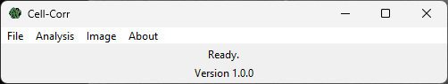
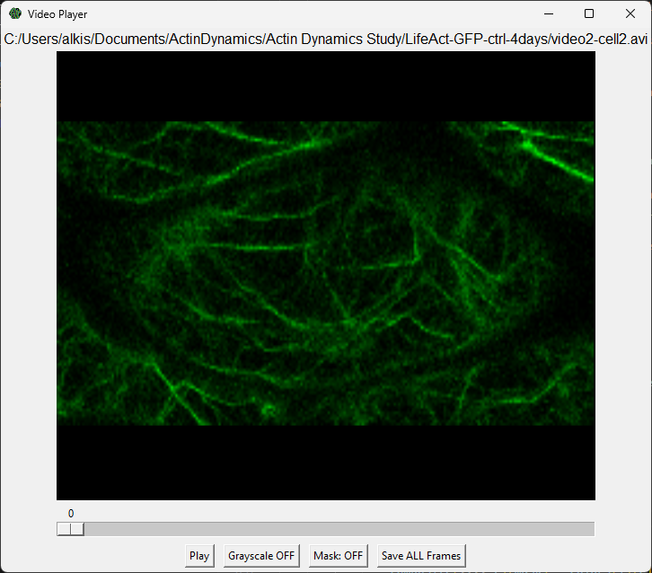
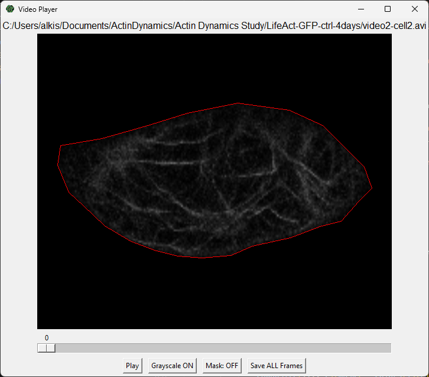
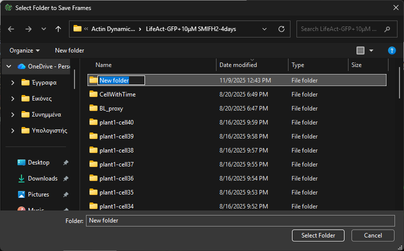
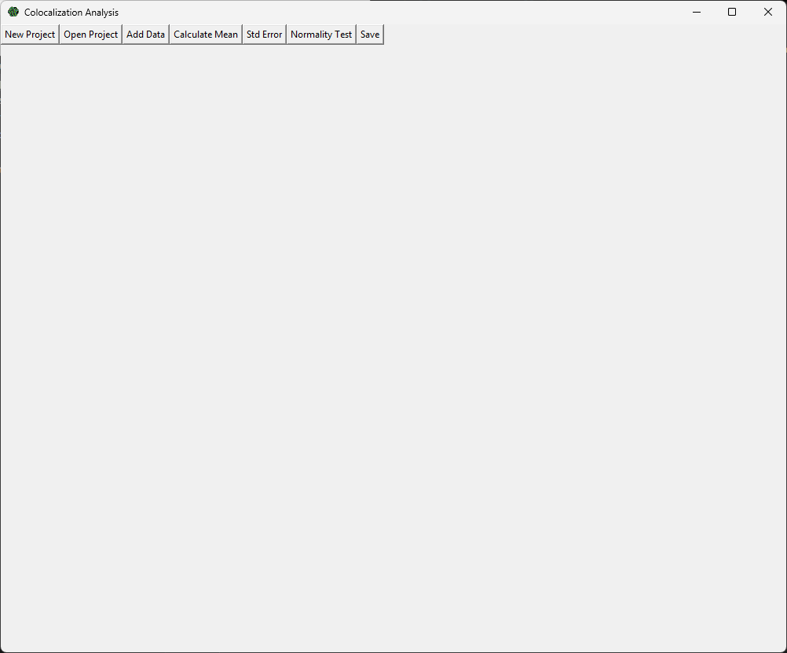
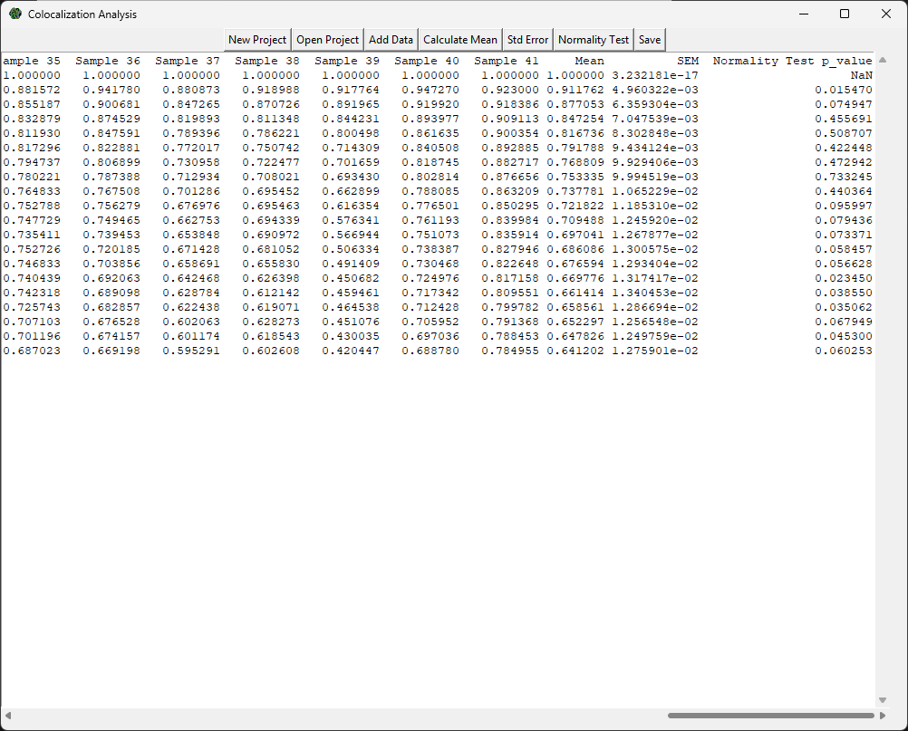

# Cell-Corr 


Alkiviadis Athanasiadis, Veronica Giourieva, George Komis

Department of Botany, School of Biology, Aristotle University of Thessaloniki 54124, Thessaloniki Greece

contact: alkathnik@bio.auth.gr, alkisathan03@gmail.com

---
## Description 
**Cell-Corr** is a Python-based, user-friendly software for **descriptive analysis of the dynamics of intracellular components**, such as actin microfilaments. Using the **Pearson’s Correlation Coefficient** (PCC), Cell-Corr provides a complete descriptive dynamics analysis of **live-cell** imaging data received by laser scanning confocal microscopy. It quantifies, via PCC, the differences between pairs of frames spaced at all time intervals throughout the whole time series. Unlike currently available software for **colocalization analysis**, Cell-Corr offers a complete workflow that includes video editing (cell selection), colocalization analysis, **exponential decay model fitting, statistical testing (ANOVA and Kruskal–Wallis with post hoc analysis)**, and the export of **ready-to-use figures**. With an intuitive graphical user interface (GUI) based on tkinter, Cell-Corr is designed to meet the needs of **biologists** without coding expertise.

## Systems Requirements 
Before you install **Cell-Corr** on your computer make sure that the following requirements are sutisfied:

Component | Minimum | Recommended
--- | --- | --- 
**CPU** | Dual-core Intel or AMD 2.0GHz | Quad-core @ 3.0+ GHz
**RAM** | 4GB | 8GB or more
**GPU** | Integrated GPU sufficient for OpenCV CPU decoding| Dedicated GPU (NVIDIA) with CUDA Cores
**Storage** | At least 1GB free storage | ≥2 GB free storage 
**OS** | Windows 11 (64-bit) | 

## Installation
To install Cell-Corr download the latest zip file from the releases section. After downloading extract the folder on the destination folder of your option. Click the Cell-Corr.exe to run the software. ***Do not move Cell-Corr.exe out of the downloaded file. Instead create a shortcut on your desktop.*** 

If you make any changes to the code you can easily create an executable with pyInstaller:

```console
C:\Users\user\Desktop\Cell-Corr_1.0.0>python -m PyInstaller --onefile --noconsole Cell-Corr.py
 ```


## Step-by-step guidelines for users
After successfully running Cell-Corr.exe the main menu must appear on the screen and a license notice.


### Step 1: Sample Preparation
Click File > Open Video or hit CTRL+O and from the file dialoge that will appear, chose the smaple video for preparation (format .avi or .mp4). Than a videoplayer must appear.




From here, we recommend to choose Mask button and start creating a mask around the area  of interest by clicking on the image. To close the poligon click very close to the first selected point (10 pixels near it). Hit the grayscale button for sample to become ready for colocalization analysis.  Lastly, save the frames of the video on a separated file of your choise. 
Repeat the process for all the samples.





### Step 2: Colocalization Analysis
Click Analysis > Colocalization Analysis. The window shown will open.



Here, there are many options that are described in the table below.

Button | Description | Notes
--- | --- | ---
New Project | Creates a new .csv file and sets the time values. | It will ask the number of frames and the scanning speed from the microscope.
Open Project | It allowes the user to select an existing project. |
Add Data | By selecting the folder of a sample it performs the colocalization analysis and adds the values to the data frame. |
Calculate Mean | It calulates the mean value of each row without the time.|
Std Error | Calculates the standard error of each row of the data frame. |
Normality Test | Performs a normality test to check if the data correspond to a normal distribution. |
Save | Saves the data frame to a csv file for later use.|



### Step 3: Statistical Analysis

Click Analysis > Graphical Analysis to start the statistical analysis.

## Citation

No research article has been published yet.


