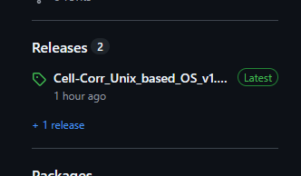

# Cell-Corr 

Alkiviadis Athanasiadis, Veronica Giourieva, Maria-Eleni Parmenidou and George Komis

Department of Botany, School of Biology, Aristotle University of Thessaloniki 54124, Thessaloniki Greece

contact: alkathnik@bio.auth.gr, alkisathan03@gmail.com

---
## Description 
**Cell-Corr** is a Python-based, user-friendly software for **descriptive analysis of the overall temporal dynamics of intracellular components**, such as actin microfilaments. Using the **Pearson’s Correlation Coefficient** (PCC), Cell-Corr provides a complete descriptive dynamics analysis of **live-cell** imaging data recieved by laser scanning confocal microscopy. It quantifies, via PCC, the differences between pairs of frames spaced at all time intervals throughout the whole time series. Unlike currently available software for **colocalization analysis**, Cell-Corr offers a complete workflow that includes video editing (cell selection), colocalization analysis, **exponential decay model fitting, statistical testing (ANOVA and Kruskal–Wallis with post hoc analysis)**, and the export of **ready-to-use figures**. With an intuitive graphical user interface (GUI) based on tkinter, Cell-Corr is designed to meet the needs of **biologists** without coding expertise.

## Installation 
### Windows Installation 
1.Download the Windows installer, Cell-Corr_windows_v1.0.0_installer, from the GitHub Releases page.
 
 

2.Execute the installer.

3.Follow the installation instructions.

### GNU/Linux and MacOS Installation
1.Download Cell-Corr_unix_v1.0.0.py from the corresponding GitHub Release.

2.Ensure that Python 3 and the required dependencies are installed.

3.Open a terminal and navigate to the directory containing the downloaded file.

4.Make the script executable and launch it:

'''console
chmod +x Cell-Corr_unix_v1.0.0.py

./Cell-Corr_unix_v1.0.0.py
'''

Alternatively, run the application through Python:

'''console
python3 Cell-Corr_unix_v1.0.0.py
'''

Dependencies: Cell-Corr requires the Python libraries used by the application. Install the required packages before launching the software. A complete list of dependencies and their compatible versions should be provided in the project documentation.

## Systems Requirements 
Before you install **Cell-Corr** on your computer make sure that the following requirements are sutisfied:

Component | Minimum | Recommended
--- | --- | --- 
**CPU** | Dual-core Intel or AMD 2.0GHz | Quad-core @ 3.0+ GHz
**RAM** | 4GB | 8GB or more
**GPU** | Integrated GPU sufficient for OpenCV CPU decoding| Dedicated GPU (NVIDIA) with CUDA Cores
**Storage** | At least 1GB free storage | ≥2 GB free storage 
**OS** | Windows 11 (64-bit) | 

## Usage Instructions
Full tutorial of how to use Cell-Corr will be uploaded on YouTube.

## Citation 
The research article describing Cell-Corr is currently in preparation. Until the article is published, please cite the software using the repository's recommended citation information, if available. 

